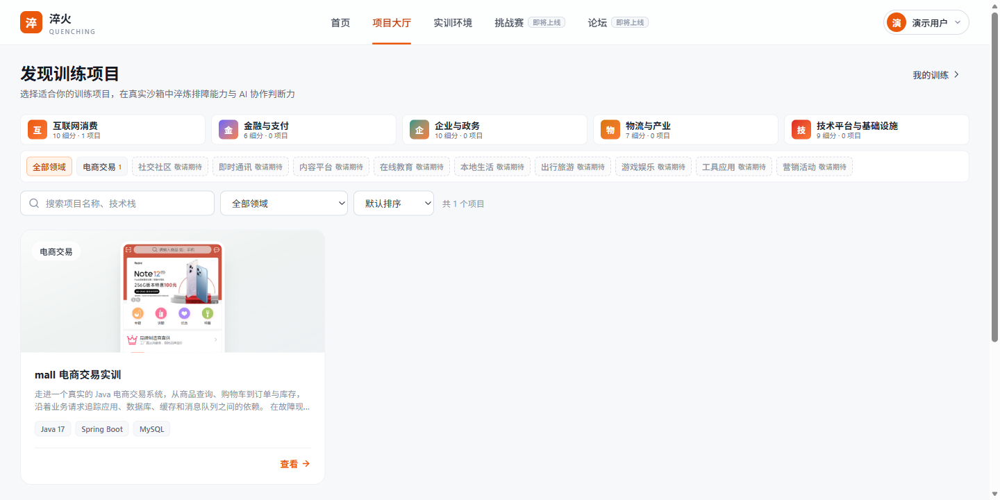
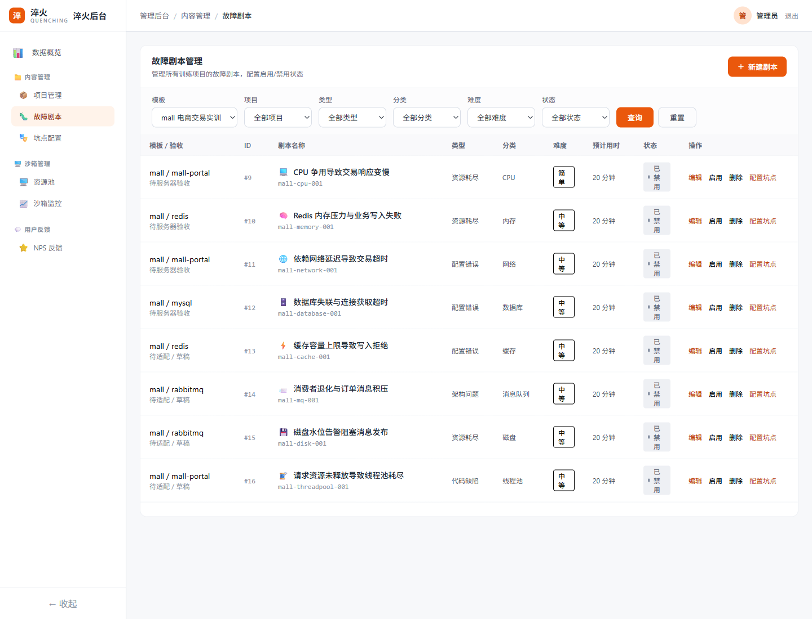

# Quenching（淬火）

> 面向 AI 时代的工程师**生产风险实战与人机协作训练平台**——用全真故障仿真，练出驾驭 AI 的工程决策力。

淬火围绕真实开源项目组织故障实训，帮助开发者从定位单个问题，逐步提升到业务恢复验证、系统分析和架构判断。AI 参与班次内挑战调度、辅助排查与整场复盘，训练目标同时覆盖工程能力进阶和人机协作。

**Quenching /ˈkwentʃɪŋ/** 即"淬火"：金属经高温骤冷而变硬，正如工程师在真实故障的高压锤炼中成长。核心理念：**实战出真知，故障炼真金**。

本仓库是淬火平台的全部代码，采用 **Monorepo** 统一管理。

当前版本为 **[0.1.0-alpha.1](https://github.com/puppet009/quenching/releases/tag/v0.1.0-alpha.1)**，正在推进真实模型接入与完整实训验证。代码实现和自动化检查不代表真实训练已经验收；模板与故障的可训练范围以对应验收结果为准。



<details>
<summary>查看管理后台：模板故障配置与验收状态</summary>



</details>

- [查看 Alpha Release](https://github.com/puppet009/quenching/releases/tag/v0.1.0-alpha.1)：源码、发布范围和已知限制。
- [征集真实故障案例](https://github.com/puppet009/quenching/issues/1)：无需提交代码，也可以分享亲历或有可靠来源的真实故障，内容请先脱敏。
- [本地开发](#十一快速开始本地开发) / [服务器部署](deploy/server/README.md)：分别用于接口联调和集群环境准备。
- [文档导航](docs/README.md)：架构、部署、模板、故障与验收入口。
- [更新记录](CHANGELOG.md) / [版本与发布约定](docs/releases.md)：变更内容、版本编号和升级规则。
- [参与贡献](CONTRIBUTING.md)：提交代码、改进文档或分享真实故障经验。

平台原创代码与文档采用 [Apache-2.0](LICENSE) 许可证。第三方源码和素材保留各自的许可证与署名，见 [NOTICE](NOTICE) 和模板来源记录。

仓库中的开发默认口令、JWT 示例和上游演示数据用于开发或隔离测试。对外部署前，请配置独立的数据库、消息队列和签名凭据，修改初始账号；不要把开发默认配置直接用于公网环境。

***

## 一、技术栈

| 层           | 技术                                             | 说明                             |
| ----------- | ---------------------------------------------- | ------------------------------ |
| 前端          | React 19.1 + TypeScript + Vite 7 + Router 7 + Tailwind 4 + Zustand | pnpm monorepo：`apps/web` 用户端、`apps/admin` 后台，双端共享层在 `packages/shared` |
| 后端（业务/基础设施） | **Go**                                         | 高性能、与 K8s 天然亲和；负责沙箱、故障引擎、业务服务  |
| 后端（AI 能力）   | **Python + FastAPI**                           | LLM 生态最好；负责复盘、助教、坑点、协作评估       |
| 服务间通信       | HTTP JSON + gRPC（契约在 `packages/proto`）            | 独立镜像部署，跨域通过鉴权接口或事件通信         |
| 沙箱与部署       | Docker + Kubernetes（MVP 可先用 Docker Compose）    | 训练环境隔离                         |
| 数据存储        | **PostgreSQL（JSONB）** + Redis + Loki | 业务数据与操作证据（沙箱域拥有源时间线，训练域拥有分析投影） / 缓存会话 / 沙箱应用日志。MVP 不引入 Elasticsearch |
| 可观测性        | Prometheus + Grafana + Loki                    | 沙箱内监控 + 平台自身监控                 |

> **架构原则：AI 负责想和调度，引擎负责实现。**

***

## 二、顶层目录结构

```
quenching/
├── apps/        # 前端应用（React + TS）
├── services/    # 后端服务（Go 微服务 + Python AI 服务）
├── packages/    # 跨服务共享代码（类型、组件、公共库、proto）
├── templates/   # 官方预置实训模板（<slug>/template.yaml 清单 + Chart，启动时自动扫描）
├── deploy/      # 部署相关（Helm Charts、Dockerfile）
├── logs/        # 运行日志（按服务/日期分目录，不纳入版本控制）
├── docs/        # 项目文档
└── scripts/     # 工具脚本（初始化、生成、运维等）
```

***

## 三、apps/ —— 前端应用

两个独立的 React + TypeScript 应用，结构一致。

| 目录            | 职责                                                                     |
| ------------- | ---------------------------------------------------------------------- |
| `apps/web/`   | **用户端 Web**：落地页、项目发现、实训环境页（Web 终端 + 监控大屏 + 告警 + 日志）、复盘报告页、个人中心（双维能力雷达） |
| `apps/admin/` | **后台管理端**：故障配置、项目管理、沙箱监控、AI 坑点配置、用户管理、数据看板（独立登录页 + 管理员角色校验）   |

双端共享的请求层、认证与工具、基础组件（Logo/DataTable/Pagination/RealtimeChart）与 Tailwind 主题统一放在 `packages/shared`（包名 `@quenching/shared`，TS 源码直接发包，无需预构建）；两个应用以 `workspace:*` 协议依赖它，应用内只保留各自独有的页面、布局与服务封装，禁止在双端复制同一份代码。

每个前端应用内部标准结构：

```
apps/<app>/
├── src/
│   ├── app/          # App 路由与全局布局
│   ├── pages/        # 页面级组件
│   ├── components/   # 可复用组件
│   ├── hooks/        # 自定义 Hooks
│   ├── services/     # API 请求封装（对接后端接口）
│   ├── store/        # 状态管理（Zustand）
│   ├── types/        # TypeScript 类型定义
│   ├── utils/        # 工具函数
│   ├── styles/       # 全局样式
│   └── assets/       # 静态资源（图片、字体等）
└── public/           # 不参与构建的公共静态资源
```

***

## 四、services/ —— 后端服务

### 4.1 Go 服务（7 个）

> **按业务域划分**：一个域一个服务目录，一份数据只有一个写入属主。当前七个 Go 服务分别构建为独立镜像，跨域消费走鉴权接口或事件，禁止互引私有实现和直接读写外域表。

每个 Go 服务遵循统一的标准目录结构：

```
services/<go-service>/
├── cmd/server/main.go   # 程序入口
├── internal/            # 私有代码（不对外暴露）
│   ├── handler/         #   HTTP/gRPC 接口层：接收请求、参数校验、返回响应
│   ├── service/         #   业务逻辑层：核心规则与编排
│   ├── repository/      #   数据访问层：数据库/缓存读写
│   ├── model/           #   领域模型：核心实体定义
│   ├── dto/             #   数据传输对象：请求/响应结构体
│   ├── config/          #   配置加载与定义
│   └── pkg/             #   服务内部工具
├── api/v1/              # API 定义（OpenAPI / proto）
├── migrations/          # 数据库迁移脚本
├── tests/               # 集成测试
├── configs/             # 配置文件（yaml 等）
├── go.mod / go.sum      # Go 依赖
├── Makefile             # 构建/测试/运行命令
└── Dockerfile           # 容器构建
```

各服务职责（按业务域）：

| 服务                  | 业务域        | 职责                                                                             |
| ------------------- | ---------- | ------------------------------------------------------------------------------ |
| `api-gateway/`      | **网关**     | 统一入口：路由转发、JWT 鉴权、限流、CORS/安全头。g7 起同进程承载 WebSocket 中枢（`/ws` 连接管理与事件分发）与内部事件发布接口（`/api/v1/events`，`X-Internal-API-Key` 鉴权），不再有独立 ws-gateway                          |
| `user-service/`     | **身份域**    | 注册/登录/个人档案；能力雷达数据的**存储与展示**（分数由 training 算好推过来，本服务不计算）；后台用户列表                    |
| `content-service/`  | **内容域**    | 训练内容库的**唯一写入属主**：项目、服务/部署配置、故障剧本、AI 坑点配置、标签、难度模板、复盘模板。纯配置 CRUD，供运行时引擎只读消费 |
| `sandbox-service/`  | **沙箱域**    | 环境创建/销毁（**控制器调谐模式**）、统一资源池与弹性控制、TTL 自动释放、状态监控；Web 终端 pty；操作源时间线唯一写入属主（`sandbox_session_operations`、`sandbox_operation_*`）；行为模拟运行时（Playwright 流量启停随沙箱生命周期） |
| `training-service/` | **训练域**    | 实训生命周期状态机（**全会话状态唯一属主**）、双维评分合并（技术分 + AI 协作分）、人机对照交叉分组（A/B 组、ai_mode）、坑点状态机编排 |
| `fault-engine/`     | **故障域**    | 故障剧本解析、ChaosBlade 注入执行、沿架构自然传导、修复判定（轮询 Prometheus）；坑点后果传导。**时间引擎（虚拟时钟/倍速）为 P1，仅预留插件位，MVP 不做**；预留 AI 行为注入器插件位 |
| `review-service/`   | **复盘/分析域** | 触发并组织复盘报告（调用 ai-service 生成）、报告存储与查询、复盘反馈；后台数据看板（只聚合各域接口数据，不拥有业务数据）                     |

> **关键归属约定**：
> - **能力雷达的"算"在 training-service**（合并技术分与协作分），user-service 只负责存和展示 `user_profiles`。
> - **配置归 content、执行归引擎**：故障剧本/坑点配置在 content-service 管理；fault-engine、ai-service、sandbox-service 运行时只读消费，不写配置。
> - **坑点是跨服务流**：ai-service 产出坑点消息 → training-service 编排坑点状态机并判定踩/识别 → fault-engine 执行恶化后果。
> - **评分两个来源合并于 training**：技术分由 training 计算，协作子分由 ai-service 提供，最终在 training 合并为双维分。
> - **操作证据归 sandbox**：训练助手执行前先写自己的 `training_tool_*` 生产日志，再可靠投递沙箱源时间线；沙箱投递 `training_operation_*` 分析投影供记忆、评分和复盘读取。生产日志和分析投影均不是第二份源时间线，分析投影不能开始工具执行。

### 4.2 Python AI 服务（1 个）

`services/ai-service/` —— 所有 AI 能力集中在此（FastAPI）：

```
services/ai-service/
├── app/
│   ├── main.py        # FastAPI 入口（HTTP/SSE，8000）
│   ├── api/           #   路由定义
│   ├── services/      #   业务逻辑：复盘引擎、助教引擎、坑点引擎、协作评估
│   ├── models/        #   Pydantic 模型
│   ├── prompts/       #   Prompt 模板（复盘/助教/坑点话术，按版本管理）
│   ├── adapters/      #   LLM 适配器（OpenAI 兼容协议，默认 qwen3.8-flash，可切换其他模型）
│   ├── grpc_gen/      #   proto 生成的 Python 代码（由 packages/proto 生成，提交仓库，禁止手改）
│   ├── grpc_server/   #   gRPC 入口与 servicer（9000，供 Go 服务调用）
│   └── config.py      #   配置
├── tests/
├── requirements.txt
├── pyproject.toml
├── docker-entrypoint.sh  # 同容器托管 FastAPI(8000) + gRPC(9000) 双进程
└── Dockerfile
```

> `grpc_gen/`、`grpc_server/` 对应第九节"gRPC 契约先行、随拆分启用"：proto 唯一来源在 `packages/proto`（见该目录 README 的生成说明），Python 生成产物落到 `app/grpc_gen/` 并提交仓库；MVP 合并部署时 gRPC 与 FastAPI 由 `docker-entrypoint.sh` 在同容器双进程托管，未来拆分微服务时以 `python -m app.grpc_server.server` 独立部署。

四大 AI 模块：

| 模块       | 职责                                                      |
| -------- | ------------------------------------------------------- |
| **复盘引擎** | 方法级复盘生成：根因 + 时间线 + 路径对比 + 亮点坑点 + 方法论 + 知识点；结构化输出与质量校验   |
| **助教引擎** | 对话管理、渐进式提示（弱引导、不泄露根因）、卡顿检测、主动推送                         |
| **坑点引擎** | 人机协作训练核心差异化：**按 content 配置产出坑点消息**（因果误判/信息遗漏/过度自信三种模式、随机置信度话术），确定性模板驱动保证 100% 触发。坑点状态机编排与踩/识别判定在 training-service，后果传导在 fault-engine |
| **协作评估** | AI 使用质量评估、三维协作指数（提问质量 + 信息利用率 + 判断力；MVP 简化版）            |

***

## 五、packages/ —— 共享代码

被多个服务/应用引用的公共代码，避免重复实现。

| 目录                        | 语言       | 职责                                |
| ------------------------- | -------- | --------------------------------- |
| `packages/shared-types/`  | TS       | 前后端共享的 TypeScript 类型定义（请求/响应/枚举等） |
| `packages/ui-components/` | React    | 共享 UI 组件库（web 与 admin 复用）         |
| `packages/go-common/`     | Go       | Go 服务公共库（日志、错误、中间件、响应格式、工具等）      |
| `packages/proto/`         | protobuf | gRPC 接口与消息定义（服务间契约的唯一来源）          |

***

## 六、templates/ —— 官方预置实训模板

存放**官方调研筛选的真实开源项目模板**，会被沙箱加载运行。**与平台代码严格隔离**：平台是"训练场"，templates 是"训练场上跑的业务系统"。

每个模板是一个以 slug 命名的子目录（`templates/<slug>/`），内含 `template.yaml` 清单（v1 规范）与 Helm Chart。目录放入即被程序自动发现，**无需在数据库登记**：

- `content-service` 启动时扫描该目录（`templates.root`，环境变量 `TEMPLATES_ROOT` 覆盖），通过 `GET /api/v1/templates` 向前端提供模板列表；
- `sandbox-service` 创建沙箱时按 `template_slug` 解析清单中的 Chart 并部署（release 名即 slug）；slug 为空则创建不预置业务系统的裸沙箱；
- `training-service` 等消费方只读取清单中的服务声明（`recovery.services` 配置），不硬编码服务名。

> **边界与扩展**：这里不放自研靶场/演示代码；故障剧本、AI 坑点配置也不放在模板里，由 `content-service` 统一管理。未来用户自定义上传的项目不进本目录，走对象存储（MinIO/OSS）+ 数据库登记，由 `packages/go-common/templates` 的 `Registry` 接口新增来源实现接入，业务服务零改动。清单字段、校验规则与 Chart 契约见 `templates/README.md`。

***

## 七、deploy/ —— 部署

| 目录               | 职责                                   |
| ---------------- | ------------------------------------ |
| `deploy/helm/`   | Kubernetes Helm Charts（各服务的部署模板）     |
| `deploy/docker/` | 各服务 Dockerfile 与本地开发用 docker-compose |

***

## 八、docs/ 与 scripts/

| 目录         | 职责                                       |
| ---------- | ---------------------------------------- |
| `docs/`    | 项目文档：架构说明、接口约定、运维手册、ADR（架构决策记录）等         |
| `scripts/` | 工具脚本：环境初始化、代码生成（proto/CRUD）、数据迁移、本地一键启动等 |

***

## 九、MVP 部署策略（重要）

当前部署口径：

- **七个 Go 服务分别构建、独立部署**，共用 PostgreSQL 实例，各域有独立迁移表和明确表属主；

- **Python AI 能力合并为一个 FastAPI 应用**部署；

- 跨域调用使用鉴权 HTTP JSON 或 gRPC；传输契约统一在 `packages/proto`，服务实现留在所属域。

服务器首次安装和存量升级以 `deploy/server` 为准。属主迁移保留旧表作历史备份，运行时只使用新属主表；升级需要暂停入口、结束旧班次、备份并停旧写入者。

***

## 十、开发约定

- **Git 工作流**：当前日常开发保留 `main` 主干，外部贡献通过 Fork 和 PR 合入；公开版本用 Tag 固定。提交方式见 [参与贡献](CONTRIBUTING.md)。

- **配置化优先**：能通过配置实现的绝不写死——项目、故障、AI 坑点、复盘内容全部配置化。

- **架构先行**：数据结构与接口预留 L4–L5 扩展（Agent 委托、失控接管），功能逐步落地，不推翻重做。

- **只做加法不做重构**：新能力（如 AI 坑点引擎）作为独立模块接入，默认值兼容现有逻辑。

- **业务域边界（强约束，用 lint 卡住）**：
  - 每个服务拥有自己的表（schema/表前缀隔离），**禁止跨服务直接读别人的表**，只读消费一律走接口或事件。
  - Go 服务间**禁止互引 `internal`**，公共能力只能放 `packages/go-common`、契约只能走 `packages/proto`。
  - 前端 `packages/shared-types` 的类型从 OpenAPI/proto **自动生成，禁止手写**。
  - `packages/go-common` 只放响应/错误/日志/配置/DB 助手/事件总线客户端，**不放业务逻辑**。
  - 会话状态、坑点状态机的唯一属主是 `training-service`；操作时间线的唯一写入方是 `sandbox-service`。
  - 可独立运行 `python scripts/qa/domain-boundaries.py` 检查本次治理的 SQL 属主、跨服务 internal 导入及共享包边界；它是源码护栏，不替代权限/运行环境验收。

> 对外开发约定以本 README 和 [参与贡献](CONTRIBUTING.md) 为准；数据结构以各服务的迁移与模型为准，服务间接口以 `packages/proto` 和 [公开 API 契约](docs/api/brain-status.openapi.yaml)为准。

***

## 十一、快速开始（本地开发）

本节用于本地账号、项目目录及接口开发。完整沙箱实训还依赖 Kubernetes、模板镜像、故障执行器和模型配置，按 [服务器部署手册](deploy/server/README.md)与 [实训验证指南](docs/testing.md)准备；本地启动和 mock 回复不代表真实实训已经验收。

### 准备工具与依赖

需要 Git、Go 1.27、Node.js 22.20+、pnpm 9.15.9、Python 3.12、Docker Engine/Desktop 和 Docker Compose 插件，以及 Bash、GNU Make。下列命令使用 Linux/macOS 的 Bash 路径；Windows 可使用 WSL2，原生 Windows 的虚拟环境激活路径见 [Python venv 文档](https://docs.python.org/3.12/library/venv.html)。

迁移命令还需要带 PostgreSQL 驱动的 [golang-migrate CLI](https://github.com/golang-migrate/migrate/tree/master/cmd/migrate)。以下固定使用 `v4.19.1`；若设置了自定义 `GOBIN`，将对应目录加入 `PATH`：

```bash
go install -tags 'postgres' github.com/golang-migrate/migrate/v4/cmd/migrate@v4.19.1
export PATH="$(go env GOPATH)/bin:$PATH"
migrate -version

git clone https://github.com/puppet009/quenching.git
cd quenching
pnpm install --frozen-lockfile
python -m venv .venv  # 确认 python --version 为 3.12
source .venv/bin/activate
python -m pip install -r services/ai-service/requirements.txt
```

### 启动中间件并迁移

在仓库根目录准备本地配置。Go 服务读取进程环境变量及各自的 `configs/config.yaml`，不会自动加载根 `.env`；修改 `.env` 后需要在对应终端重新导出并重启进程。

```bash
cp .env.example .env
# 根据本机端口与数据库配置修改 .env，再导出为当前终端的环境变量。
set -a
. ./.env
set +a
make deps-up
docker compose -f deploy/docker/docker-compose.yml ps

# 确认 PostgreSQL 已健康，再执行全部服务迁移。
make migrate
docker exec -it quenching-postgres psql -U quenching -d quenching -c '\dt'
```

Compose 仅启动 PostgreSQL、Redis、RabbitMQ 和 Prometheus，不启动平台服务、Loki 或沙箱内的商城依赖。自定义 `DB_DSN` 时，各 Go 服务与迁移使用同一份本地数据库配置。

### 启动登录和项目目录所需进程

以下进程会持续占用终端，**每行在一个新的终端中执行**。各终端先进入仓库根目录，并运行上面的 `set -a` / `. ./.env` / `set +a`，加载同一份配置。

| 进程 | 在仓库根目录执行 | 作用 |
| --- | --- | --- |
| 用户服务 | `(cd services/user-service && go run ./cmd/server)` | `8085`：注册、登录与角色查询 |
| 内容服务 | `TEMPLATES_ROOT="$PWD/templates" make dev-content` | `8082`：项目、模板及配置查询；显式指定模板目录 |
| API 网关 | `(cd services/api-gateway && go run ./cmd/server)` | `8080`：前端统一入口、JWT 校验和代理 |
| 用户端 | `make dev-web` | `5173`：用户界面 |
| 管理后台（可选） | `make dev-admin` | `5174`：独立后台界面，需管理员角色 |

两个前端的 `/api` 和 `/ws` 默认都代理到 `http://localhost:8080`。只启动内容服务不能完成默认前端的登录流程；网关与用户服务必须使用相同的 `JWT_SECRET`，未设置时二者使用相同的本地开发默认值。对外部署必须替换该值及其他开发凭据。

访问用户端的登录/注册页后，再检查 `/projects` 的项目与模板请求。默认开发配置未接入真实短信服务，账号密码注册不证明手机号或邮箱归属。管理后台还会校验 `admin` 角色，本地迁移中的开发账号见 [用户种子数据](services/user-service/migrations/000006_seed_admin_and_roles.up.sql)，仅用于隔离开发环境。

可以分别请求 `http://localhost:8080/health`、`http://localhost:8085/health` 和 `http://localhost:8082/health` 检查进程响应；健康接口成功不代表登录、数据或完整训练业务已经通过验证。

### AI 接口联调与 mock 范围

AI 服务使用前面安装的虚拟环境。在仓库根目录的新终端中执行：

```bash
source .venv/bin/activate
set -a
. ./.env
set +a
APP_ENV=development LLM_MOCK=true make dev-ai
```

`make dev-ai` 只启动 FastAPI HTTP（`8000`）。Go 服务使用 AI gRPC 时，还需在另一个终端启动 `9000`：

```bash
source .venv/bin/activate
set -a
. ./.env
set +a
(cd services/ai-service && APP_ENV=development LLM_MOCK=true python -m app.grpc_server.server)
```

HTTP 健康状态见 `http://localhost:8000/health`，其中 `llm_mock` 应为 `true`。`LLM_MOCK=true` 只替代模型调用，不会提供 Kubernetes、商城业务、指标、故障注入或数据库的模拟实现；mock 输出不用于证明真实模型或实训质量。

训练、复盘、沙箱与资源管理页面还依赖对应后端和基础设施，不能仅凭上述进程判断其可用。各 Go 服务端口为：api-gateway `8080`、content-service `8082`、user-service `8085`、training-service `8086`、review-service `8087`、fault-engine `8088`、sandbox-service `8089`；需要联调时，在对应服务目录执行 `go run ./cmd/server` 并配置其依赖。

### 数据库归属与外键约定

- 表按数据所有权放在对应服务的 `services/<svc>/migrations/`，版本号在该服务目录内独立递增（一表一迁移，`up/down` 成对）。当前归口：
  - user-service：`users` `user_profiles` `roles` `user_roles`
  - content-service：`projects` `project_services` `project_deploy_configs` `content_defects` `content_ai_pitfall_configs` `content_fault_combinations`
  - fault-engine：`fault_commands` 等执行状态；故障配置只读消费内容域接口
  - sandbox-service：`sandboxes` `behavior_scenarios` `sandbox_session_operations` `sandbox_operation_*`、资源池表、行为命令与沙箱审计
  - training-service：`training_sessions` `session_defects` `ai_conversations` `ai_messages`、坑点运行态/大脑/记忆/复盘快照、`training_tool_*` 生产日志和 `training_operation_*` 分析投影
  - review-service：`reviews`
- **同一服务内、无环引用才建物理外键**（如 `session_defects.session_id → training_sessions`）。
- 旧 `defects`、`ai_pitfall_configs`、`fault_combinations`、`session_operations`、`operation_*` 保留用于历史迁移和备份，应用不再读写。首次安装仍需先跑历史 fault/training 迁移；不能只单独跑 content/sandbox 新属主迁移。
- **跨服务引用一律用普通 `BIGINT` 列 + 索引，不建物理外键**：各服务迁移独立排序、共库执行，跨服务外键会造成建表顺序耦合，且 `sandboxes.session_id ↔ training_sessions.sandbox_id` 是循环引用。引用完整性由编排层保证。
- 新表自带全库约定列 `tenant_id BIGINT NOT NULL DEFAULT 0` 与 `deleted_at TIMESTAMPTZ`。
- JSONB 的 GIN 索引只给确有筛选场景的字段建（如 `content_defects.trigger_config`）。

## 十二、如何新增一个模块（必读范式）

**Go 后端**：照 `content-service` 的分层，一个领域实体贯穿四层——
`internal/model`（实体）→ `internal/repository`（pgx 读写，JSONB 用 `json.Marshal`）→ `internal/service`（业务规则）→ `internal/handler`（Gin + `response.OK/Fail`），在 `cmd/server/main.go` 装配并注册路由。统一响应、错误码、日志、PG 连接全部来自 `packages/go-common`，不要自造。

**Python AI**：在 `app/services/` 写生成与评估逻辑，调 `app/adapters/llm_client.py`，结构化输出用 Pydantic 校验。助手工具循环与班次流程由 training-service 编排，工具执行经过白名单、权限和操作证据约束。

**前端**：在应用的 `src/services/` 加接口（走统一 `http` 实例），`src/pages/` 加页面，`src/app/router.tsx` 注册路由；web/admin 双端都会复用的请求层、组件、工具与主题放进 `packages/shared` 并从 `@quenching/shared` 导出，不要在两个应用间复制。

## 十三、当前开发与验收重点

- 接入真实模型，验证大脑、实训助手和整班次复盘的实际调用与输出。
- 完成首个 mall 模板的真实交易、故障注入、排查修复、业务恢复、复盘与环境重置闭环。
- 首批候选故障按当前模板版本逐项验收，通过后再启用；见 [故障目录](docs/mall-first-batch-faults.md)。

真实环境步骤见 [实训验证指南](docs/testing.md)和 [mall 验收清单](templates/mall/ACCEPTANCE.md)。公开版本的编号和发布范围按 [发布约定](docs/releases.md)记录。

